  
  
  
  

<b>Welcome, fellow nerds!</b> I'm Flan, an electrician-turned-software-engineer from Germany 🇩🇪 
I mostly write <b>C#</b>, build stuff for games I play, and try (and fail) to avoid JavaScript.

## 🧰 Toolbox

  
   
  

JavaScript is on the list under protest.

## 🛠️ What I'm building
<table>
<tr>
<td width="50%" valign="top">

### 🧩 [F3M](https://github.com/FlanderDev/F3M)
**A mod hub and mod manager for a BepInEx-modded Unity game.** 
A website where authors upload mods and players browse them, plus a desktop app that installs mods with all their dependencies and removes them cleanly.

- Mod types, versioning, dependencies, optional files, tag voting
- **Signed catalog**, works offline, `f3m://` deep links
- Desktop app updates itself on Windows and Linux
- ~200 community mods imported and claimable by their authors

 

</td>
<td width="50%" valign="top">

### ⚡ [RouteGen](https://github.com/FlanderDev/RouteGen)
**A Roslyn source generator for hosted Blazor WebAssembly apps.** 
Define your API once as a C# interface. RouteGen generates the rest:

- an abstract ASP.NET Core controller base (server)
- a strongly typed `HttpClient` implementation (client)
- typed page-route helpers from `@page` directives

One source of truth for routes, so URL strings can't drift out of sync. F3M runs on it.

 

</td>
</tr>
</table>

## 📦 Other projects
| Project | What it does | Stack |
|---|---|---|
| [Windows-Service-Installer](https://github.com/FlanderDev/Windows-Service-Installer) | Interactive console-app for managing  Windows services |  |
| [ImageSorter](https://github.com/FlanderDev/ImageSorter) | Android app for sorting images into folders |  |
| [Pixel-Monitor-and-Trigger](https://github.com/FlanderDev/Pixel-Monitor-and-Trigger) | Watches a pixel or screen area and triggers actions when it changes |  |
| [MassImageRenamer](https://github.com/FlanderDev/MassImageRenamer) | An extremely simple image sorter that works |  |
| [MikuFlasher](https://github.com/FlanderDev/MikuFlasher) | A joke app that fakes a camera-based verification process |  |
| [spirited_code](https://github.com/FlanderDev/spirited_code) | Advent of Code across years and languages: [XOYZ69/spirited_code](https://github.com/XOYZ69/spirited_code) |  |

### ✂️ Useful gists
- [**Editable `Console.ReadLine`**](https://gist.github.com/FlanderDev/668c7ec28cd1d7c28d4cde939462f890): prefill the console input buffer and let the user edit it, with arrow keys, backspace and delete.
- [**`CliFillAttribute`**](https://gist.github.com/FlanderDev/446704382ace664e719fa82f0e530a90): create and populate a class instance from console input, driven by attributes.

## 👋 About me

- 🔌 Started out as a vocational **electrician**, got hooked on programming, and now work as a **software developer/engineer** with experience in several international environments.
- 💜 **C#** won my heart, but I keep widening my tools; **Kotlin/Java** for Android, a bit of **Rust**.
- 🕹️ I love learning how software works. Modding Unity games via BepInEx keeps that interest up .Although IL2CPP can be a hassle.
- 🌐 Being terminally online definitely helps 😄
- ⚡ **Fun fact:** I love playing sports, and yet I'm lazy as hell.
- 💬 Talk to me about anything .NET, source generators, modding, anime, or IT in general & you've got my intrest.

 

---

<picture>
  <source media="(prefers-color-scheme: dark)" srcset="https://raw.githubusercontent.com/FlanderDev/FlanderDev/output/snake-dark.svg" />
  
</picture>
